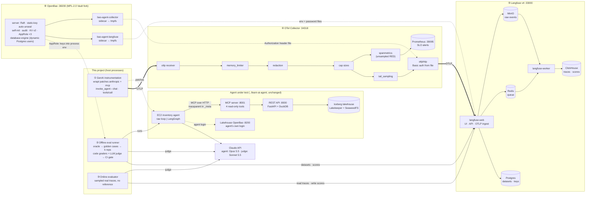

# Agent evals and observability

A hands-on course in making an AI agent *measurable*: tracing every step it takes, testing it with a
repeatable eval suite, scoring production traffic, and keeping every secret in OpenBao. The agent under
test is the EC2-inventory agent from [learn-ai-agent](https://github.com/ankitkhare-joyent/learn-ai-agent) (Claude + MCP tools over an Iceberg lakehouse),
used as-is: nothing in that folder is changed.

## Results

From an [example eval run](docs/example-eval-report.md) of the raw-loop agent (22 scored runs, k=2 repetitions):

| Metric | Result |
|---|---|
| Overall pass rate | 82% (95% CI 61% to 93%) |
| Tool use, grounded IDs, facts | 100% |
| LLM-judge correctness | 86% |
| Reliability | pass@k 91%, pass^k 73% |
| Latency | p50 5.6 s, p95 15.0 s |
| Cost | $0.023 per run |

## What I took away

With 22 scored runs, an 82% pass rate could really be anywhere from 61% to 93%, so the report shows confidence
intervals next to every rate. Small eval sets need honest error bars.

pass@k and pass^k were further apart than I expected. The agent got the right answer at least once in 91% of cases,
but every time in only 73%, and users notice the second number.

The deterministic graders (tool use, grounded IDs, facts) run first because they're free and repeatable, and the LLM
judge only covers what code can't check, like correctness of the prose and instruction-following. Everything is traced
with the OpenTelemetry GenAI conventions, so offline evals and production traffic land in the same place (Langfuse)
and can be compared.

## The system at a glance



Details and a walkthrough: [docs/12-architecture.md](docs/12-architecture.md).

## Read in this order

| # | Lesson | You'll understand |
|---|---|---|
| 01 | [Why evals and observability](docs/01-why-evals-and-observability.md) | the flywheel, vocabulary |
| 02 | [OpenTelemetry and the GenAI conventions](docs/02-opentelemetry-genai.md) | spans, attributes, MCP propagation, 2026 status |
| 03 | [Instrumenting the agent](docs/03-instrumenting-the-agent.md) | how auto-instrumentation works, cost tracking |
| 04 | [The Collector pipeline](docs/04-collector-pipeline.md) | redaction, tail sampling, spanmetrics, routing |
| 05 | [Langfuse and the landscape](docs/05-langfuse.md) | architecture, alternatives, licences, job market |
| 06 | [Eval fundamentals](docs/06-eval-fundamentals.md) | graders, ground truth, pass^k, confidence intervals |
| 07 | [The eval suite, hands on](docs/07-the-eval-suite.md) | the runner, real findings, CI gate |
| 08 | [LLM-as-judge](docs/08-llm-as-judge.md) | rubric design, bias, calibration |
| 09 | [Online evals and monitoring](docs/09-online-evals-and-monitoring.md) | SLOs, PromQL, scoring production traces |
| 10 | [Secrets with OpenBao](docs/10-openbao-secrets.md) | why not Vault, auth, policies, sidecars, dynamic secrets |
| 11 | [Production checklist](docs/11-production-checklist.md) | everything above as a review list |
| 12 | [Architecture](docs/12-architecture.md) | the whole system in one diagram |

## Run it

Needs Docker (about 2.5 GB free in the Docker VM) and [mise](https://mise.jdx.dev). Run one lab at a time.

```bash
mise trust && mise install
mise run setup            # Python deps (uv) + OpenBao bootstrap key material in .bao/
mise run agent-up         # the agent under test: lakehouse + REST API + MCP server (../learn-ai-agent)
mise run up               # OpenBao -> seed secrets -> sidecars, Collector, Langfuse, Prometheus
mise run import-key       # ANTHROPIC_API_KEY from ./.env into OpenBao (first time / on rotation)
mise run langfuse-login   # Langfuse URL and login

mise run test             # grader + instrumentation unit tests (no network, no key)
mise run trace -- "Which account has the most running vCPUs right now?"
mise run eval             # offline eval suite -> reports/<run>/summary.md, scores in Langfuse
mise run online-eval      # judge a sample of recent real traces
mise run down             # stop (data kept)
```

First start of Langfuse runs ~100 database migrations and can take 10+ minutes on a busy laptop.

| Service | URL |
|---|---|
| Langfuse | http://localhost:33000 |
| OpenBao UI | http://localhost:38200/ui |
| Prometheus | http://localhost:39095 |
| OTLP (Collector) | http://localhost:34318 (HTTP), localhost:34317 (gRPC) |

## Layout

```
observ/          telemetry setup, GenAI instrumentation, OpenBao client, agent adapter, `trace` CLI
evals/           golden-case oracle, graders (code + judge), runner, report, online evals, judge calibration
stack/           OpenBao (server, policies, sidecar agents, templates), Collector, Prometheus, ClickHouse configs
scripts/         OpenBao bootstrap/seed, key import, Langfuse login, dynamic-credentials demo
tests/           unit tests for graders and instrumentation
docs/            the lessons
.github/         example CI workflow (evals as a PR gate, OIDC to OpenBao)
```

Secrets: none in git. `.env` (the Anthropic key seed) and `.bao/` (unseal key, admin password, AppRole
credentials) are gitignored and local to this machine.

---

Part of a set of hands-on labs: [learn-ai-agent](https://github.com/ankitkhare-joyent/learn-ai-agent) · [semantic-txt-2-sql](https://github.com/ankitkhare-joyent/semantic-txt-2-sql) · [agent-evals-observ](https://github.com/ankitkhare-joyent/agent-evals-observ). More at [ankitkhare.dev](https://ankitkhare.dev).
