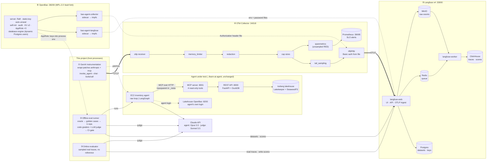

# 12 · Architecture

The whole system on one page. GitHub renders the Mermaid diagram below; numbers match the lessons.

The same system as a hand-drawn diagram, with more detail per box: [architecture.html](architecture.html)
(download it and open in a browser; GitHub shows HTML files as source).

## Follow one question through the system

1. `mise run trace -- "Which account has the most running vCPUs?"` starts a Python process. It logs into
   **OpenBao** with the `eval-runner` AppRole, puts the Anthropic key in its own environment, and
   revokes its token.
2. It installs the OTel SDK and the **GenAI instrumentation** (lesson 03), then calls the agent's own
   `ask()`. The agent fetches its inventory login from the *lakehouse's* OpenBao, as it always does.
3. The agent loops: a `chat` call to Claude, an MCP `tools/call` (with `traceparent` in `_meta`) to the
   MCP server, which calls the REST API, which reads the DuckDB hot cache over Iceberg; then Claude again.
   Each step is a span under one `invoke_agent` root.
4. Spans leave in batches over **OTLP** to the **Collector** (lesson 04): secrets masked, sizes capped,
   RED metrics counted for **Prometheus**, then tail-sampled and sent to **Langfuse** with a key that a
   sidecar rendered from OpenBao into memory.
5. **Langfuse** (lesson 05) writes the raw events to MinIO, queues them in Redis, and the worker builds
   observations with costs in **ClickHouse**. You see the trace in the UI.
6. Later, the **online evaluator** (lesson 09) samples that trace through the public API, judges it
   without a reference, and writes `online_*` scores back. A low score becomes a new golden case.
7. Before the next change ships, the **offline runner** (lesson 07) builds golden cases from live data,
   runs the agent k times per case, grades each run from its own spans plus an LLM judge, files the runs
   in Langfuse as an experiment on the dataset, and fails CI if a gate is missed.

## Where each piece lives

| Box in the diagram | Code / config |
|---|---|
| GenAI instrumentation | [observ/genai.py](../observ/genai.py), [observ/telemetry.py](../observ/telemetry.py) |
| Agent adapter (read-only import) | [observ/agent_under_test.py](../observ/agent_under_test.py) |
| Offline eval runner | [evals/run.py](../evals/run.py), [evals/cases.py](../evals/cases.py), [evals/graders/](../evals/graders/), [evals/report.py](../evals/report.py) |
| Online evaluator, judge calibration | [evals/online.py](../evals/online.py), [evals/calibrate_judge.py](../evals/calibrate_judge.py) |
| Collector, Prometheus | [stack/otel-collector/config.yaml](../stack/otel-collector/config.yaml), [stack/prometheus/](../stack/prometheus/) |
| Langfuse stack | [compose.yaml](../compose.yaml), [stack/clickhouse/low-resources.xml](../stack/clickhouse/low-resources.xml) |
| OpenBao server, policies, sidecars | [stack/openbao/](../stack/openbao/), [scripts/bao_seed.py](../scripts/bao_seed.py), [observ/secrets.py](../observ/secrets.py) |
| CI gate | [.github/workflows/evals.yml](../.github/workflows/evals.yml) |
